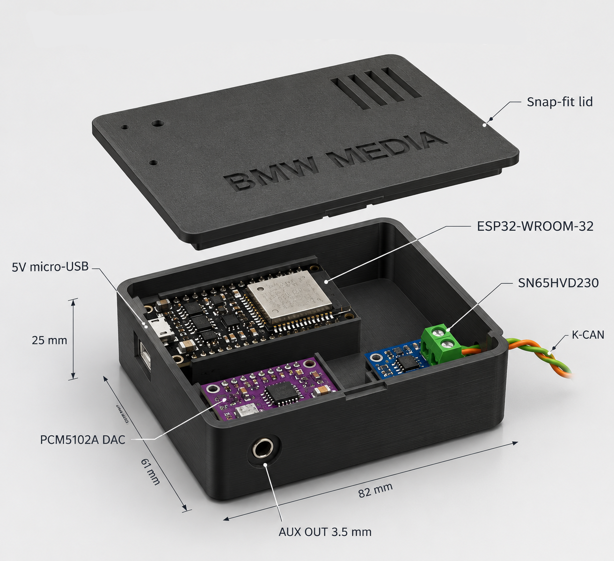

# bmw-bluetooth-media-bridge



Use the factory steering-wheel buttons of a BMW E9x (built for an E92) to
control music on the phone. An ESP32-C3 listens to the steering-wheel
message on K-CAN and sends Next / Previous / Play-Pause to the phone as
Bluetooth LE media keys. Music plays through an existing
Bluetooth-to-AUX receiver.

``` text
Steering-wheel buttons ─► K-CAN (0x1D6, 100 kbit/s) ─► MCP2515 ─SPI─► ESP32-C3
                                                                        │ BLE media keys
Phone ◄─────────────────────────────────────────────────────────────────┘
Phone ─A2DP─► Bluetooth-to-AUX receiver ─► AUX ─► car speakers
```

The phone pairs with two devices: the audio receiver and "BMW E92
Buttons". Volume stays with the factory radio.

Current firmware: **1.5** (see [Changelog](#changelog)).

## Supported cars

| Car | Status |
|---|---|
| E9x (E90/E91/E92/E93) | Verified in an E92 |
| E8x (E81/E82/E87/E88) | Expected to work (same K-CAN and 0x1D6 buttons), not tested yet |

Needs the multifunction steering wheel. Dashboard values may differ per
model; check them with the **raw** view.

## Hardware

-   ESP32-C3-DevKitM-1 (ESP32-C3-MINI-1, micro-USB via CP2102)
-   MCP2515 CAN module (MCP2515 + TJA1050, 8 MHz crystal)
-   Buck converter 12 V → 5 V
-   Inline fuse 1–2 A on the 12 V input
-   Resistors 2.2 kΩ + 3.3 kΩ (level divider)

### Wiring

| From | To | Note |
|---|---|---|
| Car +12 V | Fuse 1–2 A → Buck IN+ | Switched 12 V from the radio harness avoids battery drain |
| Car GND | Buck IN− | |
| Buck 5 V | MCP2515 VCC, C3 `5V` | Buck 3.3 V output not used |
| Buck GND | MCP2515 GND, C3 GND | Common ground |
| MCP2515 CS | C3 GPIO4 | Direct |
| MCP2515 SI | C3 GPIO6 | Direct |
| MCP2515 SCK | C3 GPIO7 | Direct |
| MCP2515 SO | C3 GPIO5 via 2.2 kΩ | Plus 3.3 kΩ from GPIO5 to GND (5 V → 3.3 V divider) |
| MCP2515 INT | C3 GPIO10 via 2.2 kΩ | Optional. Plus 3.3 kΩ from GPIO10 to GND (same divider as SO). Without it the C3 polls instead |
| MCP2515 CANH | K-CAN high (green) | Behind the radio |
| MCP2515 CANL | K-CAN low (orange) | Behind the radio |

-   Remove jumper **J1** (120 Ω terminator); the car bus is already
    terminated.
-   If the crystal is marked `16.000`, set `MCP2515_CRYSTAL_MHZ=16` in
    `platformio.ini`.
-   Leave the C3's micro-USB port reachable for flashing and serial logs.
-   Serial runs over the board's CP2102 bridge (UART0). For a C3 board
    with native USB only (e.g. SuperMini), set `ARDUINO_USB_MODE=1` and
    `ARDUINO_USB_CDC_ON_BOOT=1` in `[c3_mcp2515]`.

K-CAN (100 kbit/s) is the green/orange twisted pair behind the radio. The
OBD port (pins 6/14) is D-CAN, 500 kbit/s, diagnostics only; the gateway
most likely does not forward 0x1D6 there. The firmware is always
**listen-only**: it never transmits or ACKs on the car bus.

## Installation

1.  Wire C3 + MCP2515, create `include/secrets.h` (see
    [Wi-Fi dashboard](#wi-fi-dashboard)) and flash
    `app_ble_esp32c3_mcp2515` (see [Build](#build)).
2.  Connect to K-CAN behind the radio, ignition on, and open the serial
    monitor. Check for `CAN: MCP2515 @ 100000 bit/s listen-only`.
3.  On the phone, pair "BMW E92 Buttons" in the Bluetooth settings. Press
    each button: the monitor prints `MFL <button> -> BLE key ...` (see
    [button mapping](#button-mapping)). The dashboard's **sniffer** shows
    all CAN IDs seen.
4.  Put it in a small enclosure (PETG/ABS, not PLA) behind the radio, or
    in the armrest console powered by a dual USB adapter in the armrest
    12 V socket (shared with the Bluetooth-AUX receiver, no buck
    converter needed). The armrest keeps the C3's micro-USB port
    reachable; run the twisted K-CAN pair (~1 m) from behind the radio.
5.  Check the dashboard values with the **raw** view and correct
    `src/common/kcan_dash.cpp` if any are off.

## Button mapping

0x1D6 is 2 bytes, idle `C0 0C` (opendbc `BO_ 470 SteeringButtons`):

| Button | Byte | Mask | Frame | Action |
|---|---|---|---|---|
| Up | 0 | 0x20 | `E0 0C` | Next track |
| Down | 0 | 0x10 | `D0 0C` | Previous track |
| Vol + | 0 | 0x08 | `C8 0C` | (factory radio) |
| Vol − | 0 | 0x04 | `C4 0C` | (factory radio) |
| Telephone | 0 | 0x01 | `C1 0C` | Play/Pause |
| Voice | 1 | 0x01 | `C0 0D` | Play/Pause (on release); hold 2 s = Wi-Fi on/off |

byte0 = `0xFF` is a fault frame and is ignored. Each press sends one
command. The table lives in `src/common/mfl.cpp`.

## Wi-Fi dashboard

`app_ble_esp32c3_mcp2515` serves a live dashboard (speed, RPM, coolant,
outside temp, battery, fuel, range, last button), a CAN sniffer and a
firmware update page. Code: `src/app_ble/dashboard.*`.

**Setup**

1.  Copy `include/secrets.example.h` to `include/secrets.h` (git-ignored)
    and set the network name/password (`""` = open network) and the OTA
    password. The build stops with an error if the file is missing.
2.  Flash over USB, hold Voice 2 s and watch the serial monitor for
    `WiFi: on, network "BMW E92 Dash" at http://192.168.4.1`.
3.  On the phone join **BMW E92 Dash**, open `http://192.168.4.1` and use
    Share → Add to Home Screen.

**Usage**

-   Wi-Fi is **off** at startup. **Hold Voice 2 s** to turn it on or off
    (`w` in the serial monitor does the same). It turns off by itself
    after 10 min without use.
-   The network has no internet gateway, so the phone keeps using mobile
    data for maps and music. No phone hotspot needed.
-   The decodings in `src/common/kcan_dash.cpp` are **not verified** yet.
    Use the **raw** button to see the frame bytes. Stale values are
    dimmed.
-   **Sniffer** (`/can`): every K-CAN ID live with changed bytes
    highlighted, rate, count, filter and pause. The top line shows
    **INT OK** when the MCP2515 INT wire works (otherwise the C3 polls).
-   The C3 runs at 80 MHz with reduced Wi-Fi power to stay cool.
-   A watchdog restarts the C3 if the firmware hangs for 8 s. The status
    bar shows why it last restarted (**Reset**), in red after a crash,
    watchdog or brownout.
-   For a BLE-only firmware, set `-DENABLE_DASHBOARD=0` in
    `platformio.ini`. For bench tests without a car, uncomment
    `-DBENCH_FAKE_CAN=1` to feed fake frames.

**Firmware update (OTA)**

Tap **update** in the status bar (`/update`, user `admin`, password
`OTA_PASSWORD`) and upload
`.pio/build/app_ble_esp32c3_mcp2515/firmware.bin` (e.g. AirDrop it to the
phone). Or from a computer joined to **BMW E92 Dash**:

``` sh
pio run -e app_ble_esp32c3_mcp2515
curl -u admin -F "firmware=@.pio/build/app_ble_esp32c3_mcp2515/firmware.bin" http://192.168.4.1/update
```

`curl` asks for the password, so it stays out of the shell history.

## Build

PlatformIO project.

| Env | Purpose |
|---|---|
| `app_ble_esp32c3_mcp2515` | Steering wheel → BLE media keys + Wi-Fi dashboard |
| `app_a2dp_esp32` | Classic ESP32 (WROOM-32) all-in-one: A2DP sink → PCM5102 DAC → AUX, buttons via AVRCP, built-in CAN (TWAI) + SN65HVD230 (TX GPIO17, RX GPIO16). C3/S3 have no Bluetooth Classic |

**macOS**

``` sh
brew install platformio
cp include/secrets.example.h include/secrets.h   # then edit it
pio run -e app_ble_esp32c3_mcp2515 -t upload
pio device monitor -e app_ble_esp32c3_mcp2515
```

The CP2102 shows up as `/dev/cu.usbserial-*` (driver built in). If it
doesn't, use a data cable and plug it in directly, not via a hub's
power-only port. With several serial devices, add
`--upload-port /dev/cu.usbserial-XX`.

**Windows**

``` powershell
pip install platformio
copy include\secrets.example.h include\secrets.h   # then edit it
pio run -e app_ble_esp32c3_mcp2515 -t upload
pio device monitor -e app_ble_esp32c3_mcp2515
```

The CP2102 shows up as a `COM` port (install the Silicon Labs CP210x
driver if it doesn't). With several, add `--upload-port COMx`.

## Roadmap

-   Classic ESP32 version: Bluetooth audio (A2DP) to a PCM5102A DAC into
    AUX, buttons via AVRCP, built-in CAN (TWAI) with an SN65HVD230.
-   Per-car profiles for the whole CAN family (E8x, E9x).
-   I-Bus family (E46, E39, E53): K-Bus transceiver and CD-changer
    emulation.
-   Kit hardware: custom PCB with protected 12 V input (fuse, reverse
    polarity, TVS) and sleep or ignition-switched power.

## Changelog

-   **1.5**: Code cleanup: logger removed (the app prints button presses,
    the sniffer lists CAN IDs), 2 build environments, OTA only via
    `/update` or `curl` (ArduinoOTA removed), simpler INT check,
    `secrets.h` required for the dashboard build, Voice always acts on
    release, 8 s watchdog with the reset reason on serial and the
    dashboard.
-   **1.4**: CAN sniffer, MCP2515 INT on GPIO10, 80 MHz CPU and lower
    Wi-Fi power, macOS build setup.
-   **1.3**: Wi-Fi dashboard and OTA; hold Voice 2 s for Wi-Fi.

## References

-   <https://github.com/dzid26/opendbc-BMW-E8x-E9x>: DBC
    (`opendbc/dbc/bmw_e9x_e8x.dbc`) with the 0x1D6 definition.
-   <https://github.com/BMW-E8x-E9x/BlueGenieBMW>: E9x, MCP2515 on K-CAN
    behind the radio, Bluetooth module controlled over UART.
-   <https://github.com/meyerdominik/ESP32_bluetoothmedia>: E87, classic
    ESP32 A2DP sink + PCM5102 + K-CAN. Confirms the button codes.
-   <https://github.com/llilakoblock/bmw-e87-e90-can-bt>: ESP32-S3 + BLE
    keyboard, plus an E9x CAN ID list.
-   <https://www.loopybunny.co.uk/CarPC/can/1D6.html>: 0x1D6 details.
