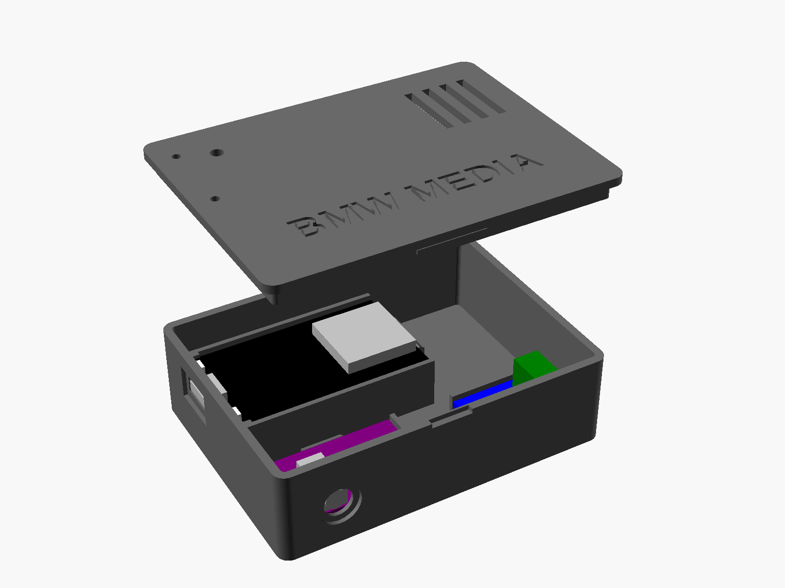

# Enclosure



Parametric OpenSCAD box for the ESP32 DevKit (30-pin), PCM5102A and
SN65HVD230. Outside 82 × 61 × 25 mm (with lid).

-   **Ports:** micro-USB left, 3.5 mm AUX front, K-CAN cable right.
-   **Boards:** slide into rails (lips at the front, click past a bump at
    the back). Lower the board behind the lips, then push it toward the
    wall.
-   **Lid:** snap-fit, pry notch at the front. Holes for BOOT/EN and the
    LED, engraved "BMW MEDIA".

## Before printing

Measure your boards and edit the values at the top of `enclosure.scad`
(board sizes, jack and USB positions, button/LED holes). The defaults are
typical sizes, not measured. Then export:

``` powershell
openscad -D "part=\"box\"" -o box.stl enclosure.scad
openscad -D "part=\"lid\"" -o lid.stl enclosure.scad
```

## Printing

-   PETG or ASA (not PLA: too hot in a car), 0.2 mm layers, no supports.
-   Box open side up, lid top face down (the STLs are already oriented).
-   Lid too tight or loose: change `snap` or `fit`.
-   Tie a zip tie around the K-CAN cable inside the wall as a pull stop.
